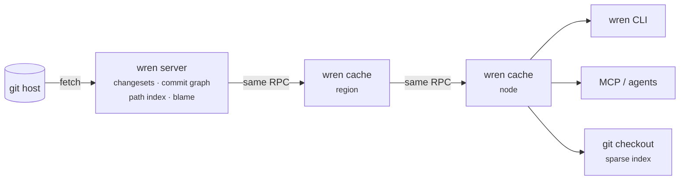

<p align="center">
  <picture>
    <source media="(prefers-color-scheme: dark)" srcset="assets/logo/wren-lockup-dark.svg">
    
  </picture>
</p>

<p align="center">
  <b>Agent-scale source control on top of git.</b><br>
  History, blame and bisect without a clone. Checkouts that cost what you read.
</p>

<p align="center">
  
  
  
  
</p>

<p align="center">
  <a href="#quick-start">Quick start</a> ·
  <a href="#how-it-works">How it works</a> ·
  <a href="docs/benchmarks.md">Benchmarks</a> ·
  <a href="docs/spec/wren-protocol-v1.md">Protocol spec</a> ·
  <a href="docs/design.md">Design</a>
</p>

---

Wren is a git-compatible acceleration layer for repositories that CI jobs and
AI agents read far more often than humans do. It sits in front of any existing
git host. There is nothing to migrate, and your git host stays the source of
truth.

|  |  |
|---|---|
| **Ask history without a clone** | Log, blame, diff, merge-base, ancestry, bisect and "which merge brought this into main?" are answered by a server over HTTP, a CLI, and an [MCP](https://modelcontextprotocol.io) server for agents. |
| **Check out only what you read** | A *want-only* object protocol through cache tiers that all speak the same RPC. A sparse checkout never fetches blobs outside its cone. |
| **Still just git** | `--git` checkouts are normal git working trees with a sparse index. Stock `git status`, `commit` and `push` work. |
| **Verified against git** | A seeded differential fuzz suite generates random histories and checks every answer against git itself. |

Wren is inspired by Anthropic's
[Scion](https://www.anthropic.com/engineering/redesigning-source-control).
That post recommends bringing Scion's most successful ideas to git *without*
leaving the git model, and Wren follows that advice.

> [!NOTE]
> **v0.1, experimental.** Wren serves reads only; writes go through
> `git push`. Each repository has one authoritative server. Object reads, and
> queries pinned to full commit ids, scale out through cache tiers. All other
> queries are computed by that one server. See
> [design §1](docs/design.md#1-目标与非目标) for the exact boundaries.

## Quick start

```sh
cargo build --release
export PATH=$PWD/target/release:$PATH

# 1. Serve a repository mirrored from any git URL (or local path).
#    Without --token, anyone who can reach the port can read every mirrored repo.
export WREN_TOKEN=$(openssl rand -hex 16)
wren server --data ./wren-data --repo git=https://github.com/git/git.git &

# 2. Optional: a cache tier. Same RPCs, so clients can't tell the difference.
wren cache --upstream http://127.0.0.1:7070 --listen 127.0.0.1:7071 \
           --upstream-token "$WREN_TOKEN" &
export WREN_SERVER=http://127.0.0.1:7071 WREN_REPO=git
```

**Ask questions without a checkout**

```sh
wren log -n 5 -- builtin/blame.c
wren blame Documentation/git-blame.adoc
wren landed <commit> --into master        # which merge brought it into master
wren merge-base master next
wren diff master~1 master --name-status
wren cat README.md --rev v2.40.0
```

**Check out only what you need, as a real git repo**

```sh
wren checkout ws --sparse t/helper --git
cd ws && git status && git log -1     # stock git works
```

**Bisect without a clone.** Each step is a fresh sparse checkout that reuses
the node-wide object store.

```sh
wren bisect --good v2.40.0 --bad master --sparse t -- make -C t test-lint
```

### For agents (MCP)

```json
{ "mcpServers": { "wren": { "command": "wren", "args": ["mcp"],
  "env": { "WREN_SERVER": "http://127.0.0.1:7071", "WREN_REPO": "git",
           "WREN_TOKEN": "…" } } } }
```

Tools: `wren_log`, `wren_show`, `wren_diff`, `wren_blame`, `wren_read_file`,
`wren_list_dir`, `wren_merge_base`, `wren_is_ancestor`, `wren_landed`,
`wren_bisect_step`, `wren_refs`.

## How it works



- **Changesets and derived data.** Each commit is ingested as the list of
  paths it changed relative to its first parent. The commit graph
  (generation numbers and first-parent skip lists) is derived recursively
  from each changeset's parents. The path index is written atomically with
  each changeset. Blame is derived lazily, one line diff per change to the
  file, from the file's change chain read in one pass over the path index;
  the result and a checkpoint every 32 changes are persisted.
- **Want-only protocol.** `POST /v1/objects {"oids": [...]}`. The client never
  describes what it has. It walks down from the root tree and asks only for
  objects it is missing. Every answer is immutable, so any tier can cache it,
  clients verify every hash, and retries resume for free.
- **Pinned queries are immutable.** A query whose revisions are all full
  commit ids can never change its answer. The server marks it
  `Cache-Control: immutable` and caches keep it forever.
- **Lean server.** The git mirror keeps refs only. Fetched packs are absorbed
  into a content-addressed object store and deleted.
- **Git compatibility.** Objects are stored and shipped in git's loose format.
  For `--git` checkouts Wren writes git's sparse index directly (stat data,
  skip-worktree bits, sparse directory entries), configures cone-mode sparse
  checkout, and sets the git host as a promisor remote.

## Benchmarks

On [git/git](https://github.com/git/git) (85k commits), against git's *best*
equivalent setup: a partial clone that really applies its filter, a
commit-graph with Bloom filters, and `worktree add` on a warm node.

| Scenario | git | Wren | |
|---|---:|---:|---:|
| History to download before the first query | 5.5 s, 117 MiB | none | |
| Sparse checkout as a git repo, cold node | 709 ms | 269 ms | 2.6× |
| Same, second job on the node | 248 ms | 100 ms | 2.5× |
| "Which merge brought commit X into HEAD?" | 90 ms | 7 ms | 13× |
| `log --first-parent -- <path>` | 50 ms | 15 ms | 3.3× |
| `blame`, warm | 86 ms | 14 ms | 6× |
| `blame`, first time for a file | 86 ms | 62 ms | 1.4× |

Full results, method and caveats, including the baseline mistakes an earlier
version made: [docs/benchmarks.md](docs/benchmarks.md).

## Documentation

| | |
|---|---|
| [Protocol spec v1](docs/spec/wren-protocol-v1.md) | Wire format, endpoints and caching rules (draft) |
| [Design](docs/design.md) | Data model, invariants, limitations, roadmap (Chinese) |
| [Scion analysis](docs/00-overview.md) | What Wren takes from Scion and why (Chinese) |
| [Design reviews](docs/reviews) | Independent reviews against the Scion article |

## Development

```sh
cargo test                                   # unit + differential fuzz (vs git) + end-to-end
WREN_FUZZ_SEEDS=1,2,3,0xbeef cargo test --release -p wren-vcs-core --test differential
```

Before changing core logic, read the invariants in
[docs/design.md §8](docs/design.md#8-不变量给人和-agent-的不清单) and
[CONTRIBUTING.md](CONTRIBUTING.md).

## License

[Apache-2.0](LICENSE)
