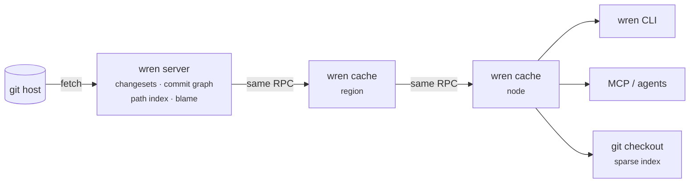

<p align="center">
  <picture>
    <source media="(prefers-color-scheme: dark)" srcset="assets/logo/wren-lockup-dark.svg">
    
  </picture>
</p>

<p align="center">
  <b>Server-side source control queries for git, in the style of Anthropic's Scion.</b><br>
  History, blame, grep and bisect without a clone, for agents and CI.
</p>

<p align="center">
  <a href="https://github.com/wrencanfly/wren/actions/workflows/ci.yml"></a>
  
  
  
</p>

<p align="center">
  <a href="#quick-start">Quick start</a> ·
  <a href="#for-agents-mcp">MCP</a> ·
  <a href="#how-it-works">How it works</a> ·
  <a href="docs/principles.md">Scion principles</a> ·
  <a href="docs/benchmarks.md">Benchmarks</a> ·
  <a href="docs/spec/wren-protocol-v1.md">API reference</a>
</p>

---

Wren runs in front of an existing git host and answers source control
questions on the server. A CI job or an AI agent can ask for log, blame,
grep, diff, merge-base, "which merge brought this into main?" or a bisect
step without cloning anything. When a job does need files, it fetches only
the objects it reads, through cache tiers that all speak the same RPC, and
gets a normal git working tree.

Your git host stays the source of truth. Wren is read-only, and writes still
go through `git push`.

## Why

Anthropic's [Redesigning source control at Anthropic](https://www.anthropic.com/engineering/redesigning-source-control)
describes how agents running all day broke the assumption that every git
client is offline and holds a full copy of history. The article does not
call for replacing git. It suggests that "Git platforms can provide
comprehensive server-side RPCs like Scion, perhaps even in a standardized way
across forges that the git client can learn to talk to."

Wren is a working, open implementation of those server-side RPCs that you can
run today, and a concrete starting point for standardizing them.
[docs/principles.md](docs/principles.md) checks Wren against each Scion
principle and lists what it deliberately leaves out.

Wren is an independent project. It is not affiliated with or endorsed by
Anthropic.

|  |  |
|---|---|
| **Ask history without a clone** | Log by path, blame, diff, merge-base, ancestry, `landed` and bisect are answered from server-side indexes: changesets, a commit graph with skip lists, a path index, and persisted blame. |
| **Search and read at any revision** | `grep`, `cat` and `ls` at any commit, with no checkout. |
| **Bounded, cacheable answers for agents** | MCP tools pin revisions to full commit ids, so answers are immutable and served by caches. Line ranges and output caps keep token use predictable. |
| **Check out only what you read** | A want-only object protocol through same-RPC cache tiers. `--git` checkouts are stock git working trees with a sparse index, so `git status`, `commit` and `push` work. |
| **Verified against git** | A seeded differential fuzz suite generates random histories and checks every answer against git itself. |

> [!IMPORTANT]
> **v0.1, experimental. Read this before you deploy.**
> - **One trust domain.** A token can read every repository on a server, and
>   the object store is shared across repositories. Run one Wren per trust
>   domain.
> - **Force-pushed content stays readable.** Objects removed from a branch
>   remain in the store.
> - **One authoritative server per repository** (SQLite). Object reads and
>   pinned queries scale out through caches; everything else hits that
>   server.
> - **No TLS of its own.** Put Wren behind a TLS-terminating proxy.
> - **Storage and incremental fetches cost more than git.** See
>   [Costs](docs/benchmarks.md#costs).

## Quick start

```sh
cargo build --release
export PATH=$PWD/target/release:$PATH

# 1. Serve a repository mirrored from any git URL (or local path).
export WREN_TOKEN=$(openssl rand -hex 16)
wren server --data ./wren-data --repo git=https://github.com/git/git.git &

# 2. Optional: a cache tier. Same RPCs, so clients can't tell the difference.
wren cache --upstream http://127.0.0.1:7070 --listen 127.0.0.1:7071 \
           --upstream-token "$WREN_TOKEN" &
export WREN_SERVER=http://127.0.0.1:7071 WREN_REPO=git
```

**Ask without a checkout**

```sh
wren log -n 5 -- builtin/blame.c
wren blame Documentation/git-blame.adoc
wren grep -i 'first.parent' builtin
wren landed <commit> --into master        # which merge brought it into master
wren merge-base master next
wren diff master --name-status          # what master changed vs its first parent
wren cat README.md --rev v2.40.0
```

**Check out only what you need, as a real git repo**

```sh
wren checkout ws --sparse t/helper --git
cd ws && git status && git log -1     # stock git works
```

**Find the commit that broke main.** Bisection runs over first-parent
history. Each step is a fresh sparse checkout that reuses the node-wide
object store.

```sh
wren bisect --good v2.40.0 --bad master --sparse t -- make -C t test-lint
```

**Freshness.** Answers reflect the git host as of the last sync. Every
unpinned answer carries a `wren-synced-at` header. A query that names a
commit Wren has not seen, for example one you just pushed, triggers one sync
before Wren answers. You can also point your host's push webhook at
`POST /api/v1/repos/{repo}/sync`.

## For agents (MCP)

```json
{ "mcpServers": { "wren": { "command": "wren", "args": ["mcp"],
  "env": { "WREN_SERVER": "http://127.0.0.1:7071", "WREN_REPO": "git",
           "WREN_TOKEN": "…" } } } }
```

| Tool | Answers |
|---|---|
| `wren_log` | First-parent history, optionally for a path |
| `wren_show`, `wren_diff` | What a commit changed; diffs between revisions |
| `wren_blame` | Who last changed each line, for a line range |
| `wren_read_file`, `wren_list_dir`, `wren_grep` | Files, directories and search at any revision |
| `wren_merge_base`, `wren_is_ancestor`, `wren_landed` | Ancestry questions, such as "did this land on main, and through which merge?" |
| `wren_bisect_step` | The next commit to test, or the first bad one |
| `wren_refs` | Branches and tags, filtered by prefix |

Every tool resolves its revisions to full commit ids first, and every answer
names the commit it describes. Outputs are capped (about 10k tokens by
default) and say when they were cut, so an agent can narrow the request
instead of guessing.

## How it works



- **Changesets.** Each commit is ingested as the list of paths it changed
  relative to its first parent. The path index is written in the same
  transaction.
- **Derived data.** The commit graph (generation numbers and first-parent
  skip lists) is derived recursively from parents. Blame is derived lazily:
  the file's change chain is read in one pass over the path index, each
  change costs one line diff, and the result plus a checkpoint every 32
  changes are persisted.
- **Immutable answers.** Objects are content-addressed. A query whose
  revisions are all full commit ids can never change its answer, so it is
  marked `immutable`. Caches keep it, keyed by a query-semantics version
  (`wren-semantics`), so an algorithm change never mixes old and new
  answers.
- **Want-only objects.** `POST /v1/objects {"oids": [...]}`. The client walks
  down from the root tree and asks only for objects it is missing. It
  verifies every hash, and retries resume.
- **Git compatibility.** Objects use git's loose format. For `--git`
  checkouts Wren writes git's sparse index directly, configures cone-mode
  sparse checkout, and sets the git host as a promisor remote.
- **Lean mirror, not a lean store.** The server's git mirror keeps refs
  only: fetched packs are absorbed into the object store and deleted. That
  store holds loose objects, which take far more disk than a git pack.

## Benchmarks

On [git/git](https://github.com/git/git) (85k commits, local machine),
against git's *best* equivalent setup: a partial clone that really applies
its filter, a commit-graph with Bloom filters, and `worktree add` on a warm
node.

| Scenario | git | Wren | |
|---|---:|---:|---:|
| History to download before the first query | 5.5 s, 117 MiB | none | |
| Sparse checkout as a git repo, cold node | 709 ms | 269 ms | 2.6× |
| Same, second job on the node | 248 ms | 100 ms | 2.5× |
| "Which merge brought commit X into HEAD?" | 90 ms | 7 ms | 13× |
| `log --first-parent -- <path>` | 50 ms | 15 ms | 3.3× |
| `blame`, warm | 86 ms | 14 ms | 6× |
| `blame`, first time for a file | 86 ms | 62 ms | 1.4× |

**Costs.** Wren's object store for git/git is 4.7 GB of loose objects, about
15× the size of a git pack. An incremental update from `HEAD~15` sends 570 KB
where a git thin pack sends 14 KB. Full results, method, corrections and
caveats are in [docs/benchmarks.md](docs/benchmarks.md).

## Roadmap

- **Upstream.** Send the [sparse/promisor report](docs/upstream/git-sparse-promisor.md)
  to the git list. Refine the [draft git protocol v2 extensions](docs/upstream/git-protocol-v2-query.md):
  a `query` command, more `object-info` attributes, and `missing-ok` for
  fetches. Add a `git-upload-pack` v2 front end so that stock git clients can
  use these RPCs.
- **Costs.** Delta frames for incremental fetches, packed storage, and
  per-repository authorization.
- **Post-merge testing.** Build a `culprit` workflow on `landed` and `bisect`.

Not planned: virtual filesystems, server-side commits, becoming the source of
truth, merge queues and code review.

## Documentation

| | |
|---|---|
| [Scion principles](docs/principles.md) | How Wren maps to each Scion principle, and where it deliberately differs |
| [API reference](docs/spec/wren-protocol-v1.md) | Endpoints, wire format and caching rules (draft, unstable) |
| [Benchmarks](docs/benchmarks.md) | Method, results, costs and corrections |
| [Design](docs/design.md) | Data model, invariants, limitations (Chinese) |
| [Reviews](docs/reviews) and [research](docs/research) | Design reviews and research notes written with AI agents during development (Chinese) |

## Development

```sh
cargo test --release                         # unit + differential fuzz (vs git) + end-to-end
WREN_FUZZ_SEEDS=1,2,3,0xbeef cargo test --release -p wren-vcs-core --test differential
```

Before changing core logic, read the invariants in
[docs/design.md §8](docs/design.md#8-不变量给人和-agent-的不清单) and
[CONTRIBUTING.md](CONTRIBUTING.md).

## License

[Apache-2.0](LICENSE)
